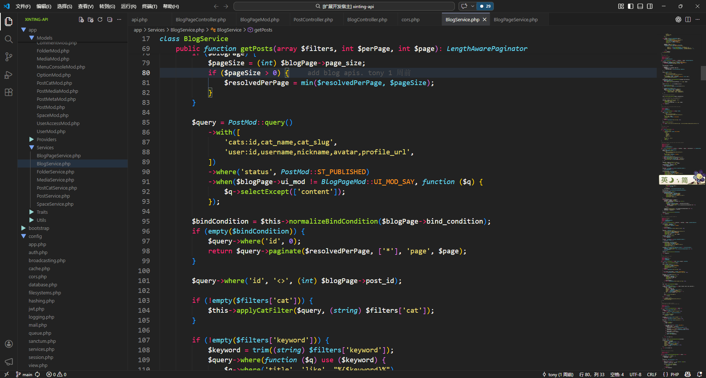
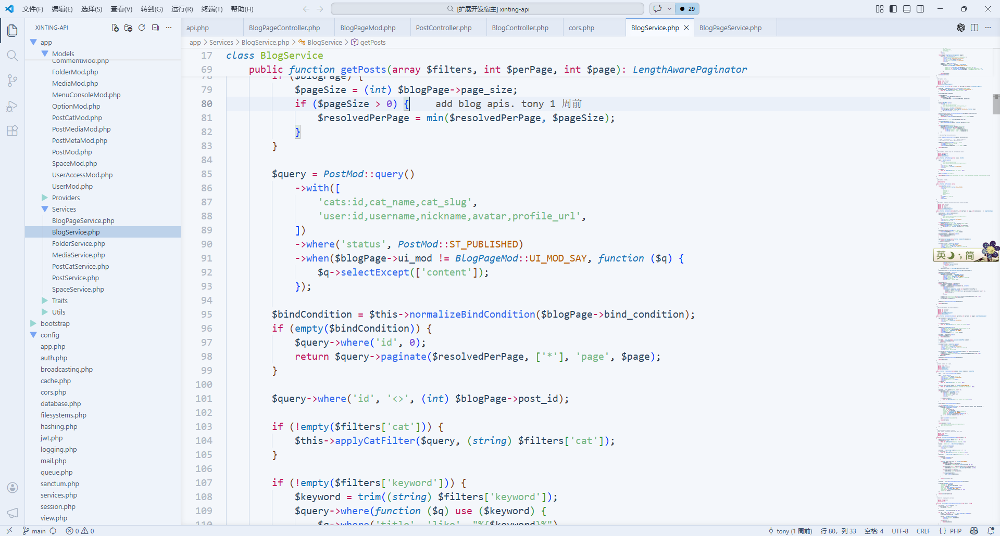

# Dusk Star

A simple monokai color theme for VS Code.

## Themes

### Dark

### Light

## File Icon Theme

Dusk Star includes an optional folder-only file icon theme. It customizes folder icons only and does not define custom file icons.

1. Open the Command Palette (`Ctrl+Shift+P` / `Cmd+Shift+P`).
2. Run `Preferences: File Icon Theme`.
3. Select `Dusk Star`.

## Credits

Folder icon shapes are adapted from the VS Code default file icon theme (MIT License, Copyright (c) Microsoft Corporation), recolored for Dusk Star.
