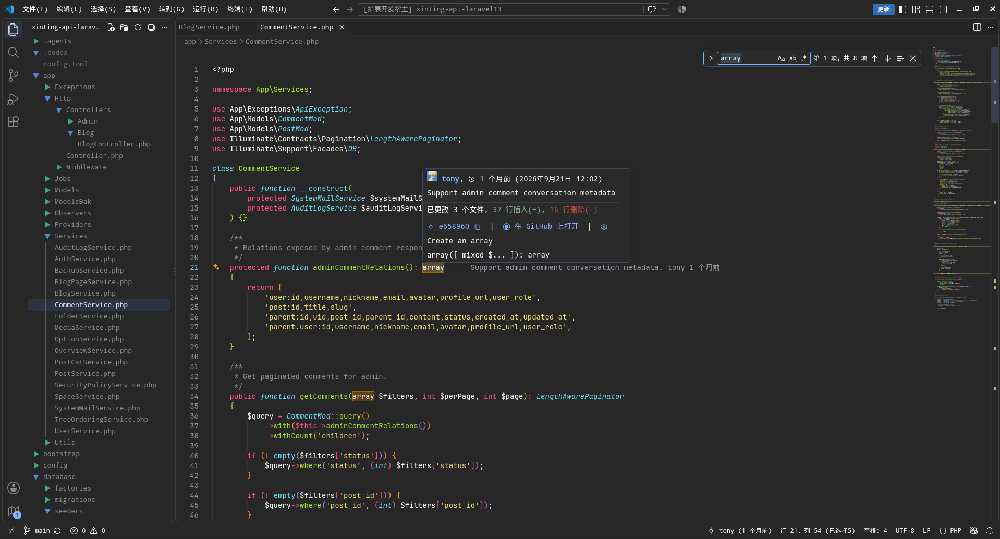
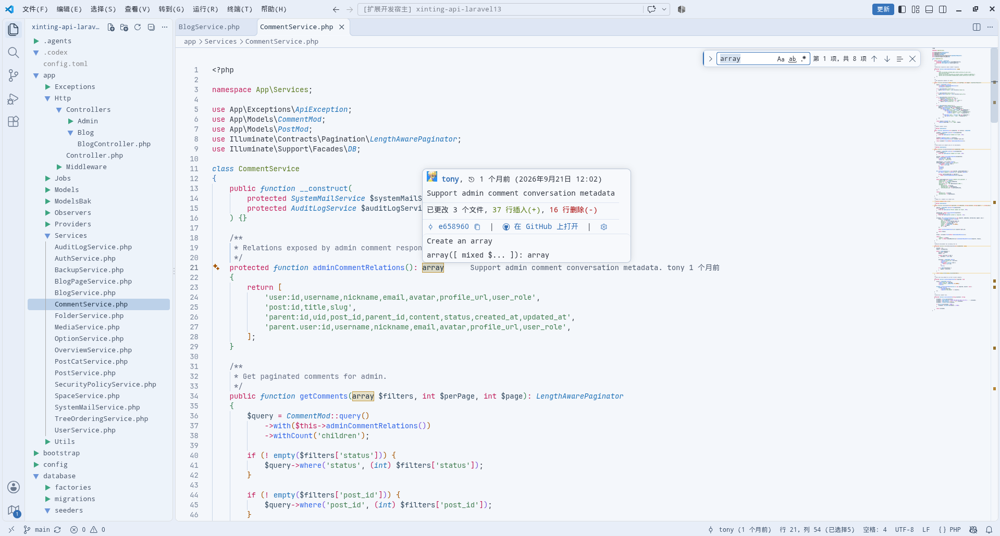

# Dusk Star

A dark and light Monokai-inspired color theme for VS Code, with an optional
folder-only icon theme.

## Themes

### Dusk Star Dark



### Dusk Star Light



## Features

- Dark and light variants with a shared Monokai-inspired palette.
- Semantic highlighting for types, functions, parameters, properties, and
  enum members.
- Distinct colors for selections, find matches, and Git status decorations.
- An optional folder-only icon theme with custom open/closed arrows.
- Color IDs, transparency, and contrast are checked in CI.

## Installation

### From the Marketplace

1. Open the Extensions view (`Ctrl+Shift+X` / `Cmd+Shift+X`).
2. Search for **Dusk Star Theme**.
3. Install the extension published by `tonyx`.

You can also run:

```bash
code --install-extension tonyx.dusk-star-theme
```

### From a VSIX

```bash
code --install-extension dusk-star-theme-<version>.vsix
```

## Activate the Theme

1. Open the Command Palette (`Ctrl+Shift+P` / `Cmd+Shift+P`).
2. Run **Preferences: Color Theme**.
3. Select **Dusk Star Dark** or **Dusk Star Light**.

Or set it in `settings.json`:

```json
{
  "workbench.colorTheme": "Dusk Star Dark"
}
```

## File Icon Theme

Dusk Star includes an optional folder-only icon theme. It uses custom
arrow-style folder icons and hides the native explorer arrows. It does not
replace file icons.

1. Open the Command Palette (`Ctrl+Shift+P` / `Cmd+Shift+P`).
2. Run **Preferences: File Icon Theme**.
3. Select **Dusk Star**.

Or set it in `settings.json`:

```json
{
  "workbench.iconTheme": "dusk-star-icon"
}
```

## Color Palette

| Role | Dusk Star Dark | Dusk Star Light |
| --- | --- | --- |
| Editor background | `#222222` | `#F4F7FB` |
| Editor foreground | `#F8F8F2` | `#2E3440` |
| Comment | `#918C7F` | `#677186` |
| Keyword | `#FF4D82` | `#C2185B` |
| String | `#E6DB74` | `#3F7E50` |
| Number | `#AE81FF` | `#7A4DD8` |
| Function / type | `#A6E22E` | `#2E66E8` / `#5A7A1D` |
| Parameter | `#FD971F` | `#A65300` |
| Selection background | `#365C8A` | `#B9D3F0` |
| Find match background | `#A66A00CC` | `#F2C14E99` |
| Git added | `#7FB4FF` | `#1F5FA8` |
| Git modified | `#FD971F` | `#7A3E00` |
| Git deleted | `#FF6B6B` | `#A31515` |
| Git renamed | `#AE81FF` | `#4B2E9E` |
| Git conflicting | `#FF4D82` | `#A3155B` |

## Customization

Override individual colors in `settings.json`:

```json
{
  "workbench.colorCustomizations": {
    "[Dusk Star Dark]": {
      "editor.background": "#1E1E1E",
      "editor.lineHighlightBackground": "#2A2A2A"
    }
  }
}
```

Override syntax colors:

```json
{
  "editor.tokenColorCustomizations": {
    "[Dusk Star Dark]": {
      "comments": "#7F8C8D",
      "keywords": "#FF6B9D"
    }
  }
}
```

## Development

Requirements:

- Node.js 20 or newer
- Python 3.11 or newer
- VS Code 1.81 or newer

Install dependencies and validate the theme data:

```bash
npm install
npm run validate
```

The validator checks JSON structure, color IDs, transparency metadata, package
metadata, the icon theme, README image references, and contrast for key editor
and UI colors. It also has a self-test:

```bash
python3 scripts/validate.py --self-test
```

Build a VSIX:

```bash
npm run package
```

The generated `dusk-star-theme-x.x.x.vsix` is written to the repository root.

Publishing is intended for maintainers and requires a Marketplace personal
access token:

```bash
VSCE_PAT=your-token npm run publish
```

The committed color-ID registry is generated from a local VS Code installation:

```bash
python3 scripts/update-color-registry.py
```

Run this after upgrading VS Code and review the resulting diff. CI uses the
committed registry and does not require VS Code.

`scripts/expected-theme-values.json` is a regression baseline for intentional
color changes. Update it only when a color change is deliberate. New dark-only
color IDs must also be added to `DARK_ONLY_ALLOWED` in `scripts/validate.py`.

The GitHub Actions workflow runs validation and packages the extension on pushes
and pull requests.

## Project Structure

```text
themes/color-dark.json    Dark color theme
themes/color-light.json   Light color theme
themes/file-icon.json     Folder-only icon theme
imgs/                     Theme icon, folder SVGs, and screenshots
imgs/archive/             Archived screenshots (not packaged)
scripts/                  Validation and registry maintenance
.github/workflows/        CI validation and VSIX packaging
```

## License

MIT. See [LICENSE](./LICENSE).

The folder SVG icons are original assets for this project and are distributed
under the same MIT license. The themes are inspired by Monokai.
